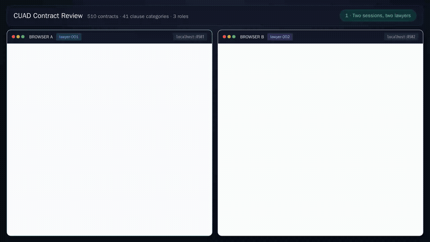
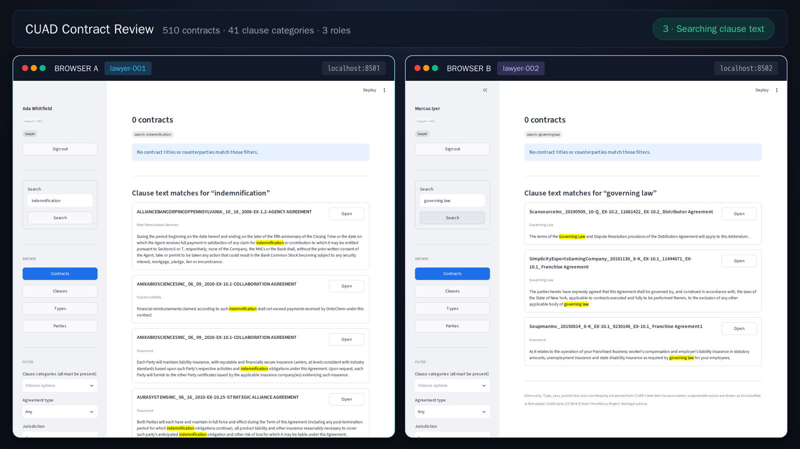
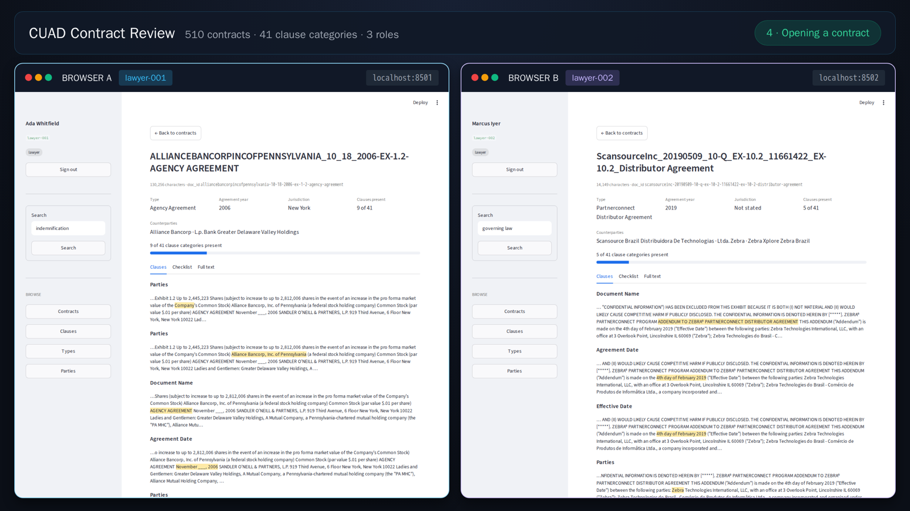
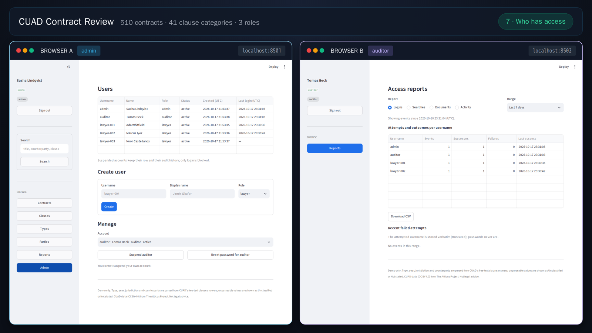
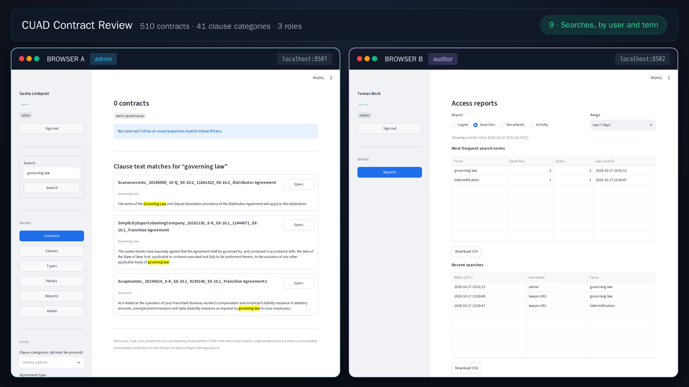

# snow-cuad

A working proof of concept: the **CUAD** contract corpus loaded into Snowflake,
with a lawyer-facing search UI, role-based access, and an access audit log.

[](https://snow-cuad.livive.net/docs/assets/demo-720p.mp4)

*[Full walkthrough](https://snow-cuad.livive.net/docs/assets/demo-720p.mp4) — 1280×720*

<!-- The video is linked by absolute URL rather than committed-relative: GitHub's
     blob viewer refuses to preview it ("we can't show files that are this big")
     and GitHub strips <video> tags from READMEs, so a Pages-hosted copy is the
     only way to get a link that actually plays. -->

---

## What this is

[CUAD](https://www.atticusprojectai.org/cuad) (Contract Understanding Atticus
Dataset) is 510 commercial contracts annotated by lawyers with 41 types of
clause that matter during M&A diligence — governing law, change of control,
non-compete, IP assignment, and so on.

This project loads that corpus into Snowflake and puts an application on top of
it:

- **Search** clause text and read the matched clause in its surrounding context
- **Browse** by clause category, agreement type, jurisdiction, counterparty or year
- **Related contracts**, scored by shared counterparty, clause overlap and type
- **Three roles** — lawyer, auditor, admin — with an admin console and an
  append-only access audit log
- **Least privilege**: the app runs as a dedicated service identity, never as
  `ACCOUNTADMIN`

Everything is reproducible from a single `make pipeline`.

## What this is not

A starting point, not a finished application — deliberately simple:

- **No semantic search.** Substring matching and structured filters only.
- **No document-level access control.** Roles decide which *pages* you get, not
  which contracts. Every lawyer sees the whole corpus.
- **No PDFs.** CUAD ships text, not documents.
- **Single tenant.** No clients, matters or per-matter isolation.
- **The counterparty dimension is noisy.** CUAD's party field is free text that
  mixes entity names with role labels, so only 29 names repeat. See
  [architecture](docs/architecture.md#counterparties-are-the-weak-axis).

## Screenshots

Searching clause text, with hits highlighted in the clause and the matched span
in amber:



A contract, its 41 annotated clauses, and the related contracts panel:



The admin console:



The auditor's report, narrating the search activity above:



More stills, one per beat of the video, are in
[`docs/assets/`](docs/assets).

## Quickstart

Needs Python 3.14, Docker (only for the demo video), and a Snowflake account.

> **This creates real objects in your Snowflake account** — a database, a
> warehouse, a role and a service user — and spends credits while it runs. It is
> small (an XS warehouse with 60-second auto-suspend), but it is your account.

```bash
make bootstrap     # venv, dependencies, .env from .env.example
$EDITOR .env       # account identifier, login, password
make doctor        # prove the connection works
make pipeline      # corpus + service identity + logins + verification
make app           # http://localhost:8501
```

`make pipeline` prints a summary as it goes and ends with `all checks passed`.
Log in with any of the five accounts in `credentials.txt`, which it writes
alongside (`lawyer-001` … `lawyer-003`, `admin`, `auditor`).

To tear it all down again:

```bash
make teardown      # drops the database, warehouse, service user and role
```

Full playbook, including what survives a teardown and the two-step rebuild:
[docs/operations.md](docs/operations.md).

## What you get

| Table | Rows | |
|---|---|---|
| `CONTRACTS` | 510 | title, length |
| `CONTRACT_TEXT` | 510 | the full contract, for whole-document search |
| `CLAUSES` | 13,823 | one row per annotated clause span, with character offsets |
| `CLAUSE_CATEGORIES` | 41 | the annotation taxonomy |
| `CONTRACT_DIM` | 510 | parsed type, year, jurisdiction, clause count |
| `CONTRACT_PARTY` | 915 | parsed counterparties |
| `RELATED_DOC` | 2,430 | top-5 related contracts per contract, with reasons |
| `APP_USERS` / `ACCESS_LOG` | — | app logins; append-only audit trail |

Plus nine views over the above. The interesting part is that **CUAD has no
metadata columns** — parties, dates and governing law exist only as free-text
clause answers, so everything in the derived tables is parsed, and unparseable
values stay visible as `Unclassified` / `Not stated` rather than becoming nulls.
Parse rates and the reasoning are in
[docs/architecture.md](docs/architecture.md).

Authentication is three layers, which is worth understanding before changing
anything:

| Layer | Identity | What it can do |
|---|---|---|
| 1 | your `ACCOUNTADMIN` login | onboarding only — `make`, DDL, grants, teardown |
| 2 | `STREAMLITWEB` (service user + role) | read the corpus, append audit rows, manage app users |
| 3 | the five logins in `APP_USERS` | sign in to the app; all share layer 2's one session |

[docs/security.md](docs/security.md) explains why, and how it is verified.

## Layout

```
Makefile              every task; `make help` lists them
sql/                  00 setup … 08 grants, 99 teardown
scripts/              download, build, load, verify, key and user provisioning
app/                  the Streamlit application
demo/                 builds the demo video (Playwright, in Docker)
docs/                 detail and design notes
.env.example          the only env file that is committed
```

## Docs

| | |
|---|---|
| [architecture.md](docs/architecture.md) | data model, derived dimensions, parse rates, related-document scoring, UI navigation |
| [security.md](docs/security.md) | the three auth layers, the grants, key-pair auth, privilege verification, trust boundary |
| [operations.md](docs/operations.md) | **the playbook** — every `make` target, teardown and rebuild, troubleshooting |
| [demo-video.md](docs/demo-video.md) | how the demo video is built, and why it needs no compositing |
| [build-notes.md](docs/build-notes.md) | the sharp edges — Snowflake and Streamlit behaviour that cost time |

## Attribution and licence

Code is [MIT](LICENSE). The CUAD dataset is by
[The Atticus Project](https://www.atticusprojectai.org/cuad) and licensed
**CC BY 4.0**; the contracts themselves are public SEC filings.

Clause spans are expert human annotations, not model output. This is a
demonstration, **not legal advice**.
